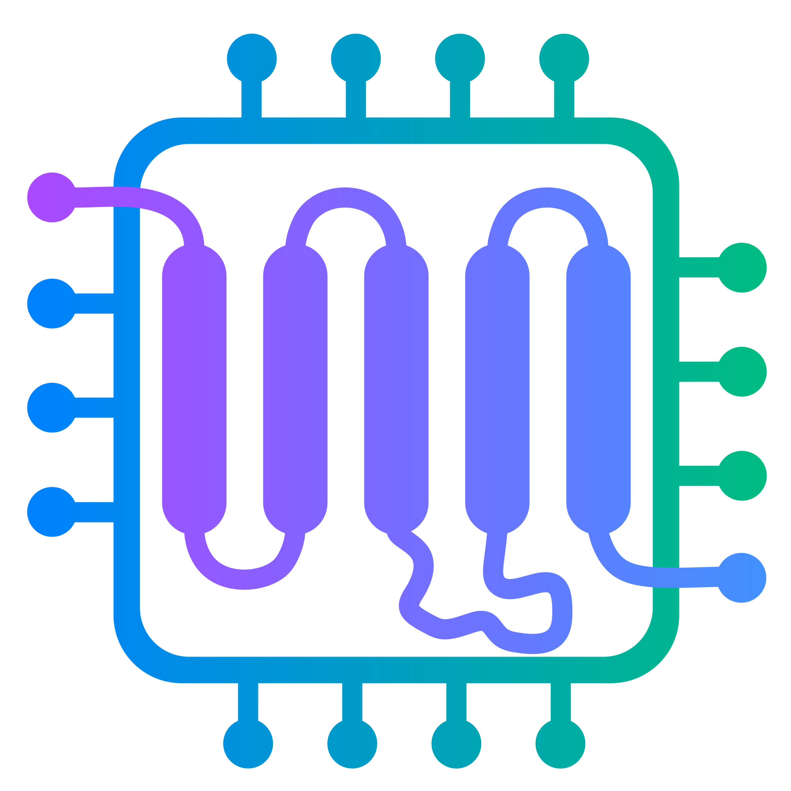

# aiida-gromacs
| Category       | Badges |
|----------------|--------|
| **Build**      |    |
| **Documentation** |   |
| **Citation**      |  |
| **PyPI**       |      |
| **Anaconda**       |     |
| **Quality**    |  |

The GROMACS plugin for AiiDA aims to enable the capture and sharing of the full
provenance of data when parameterising and running molecular dynamics
simulations. This plugin is being developed as part of the Physical Sciences
Data Infrastructure programme to improve the practices around data within the
Physical Sciences remit area within the UK.

This package is currently a work in progress and we will be adding much more
complete functionality to this plugin in the coming months.

The design pattern we are aiming for is to simply allow researchers to capture
the full data provenance for their simulations by only switching on an AiiDA
conda environment, along with modifying your command lines very slightly.

This means that you should gain access to powerful FAIR data practices without
wholesale cultural or usage pattern shifts in your daily work.

    

## Documentation

See [here](https://aiida-gromacs.readthedocs.io/en/latest/) for documentation for users and developers.

## License

MIT

## Contact

- james.gebbie@stfc.ac.uk
- jas.kalayan@stfc.ac.uk
